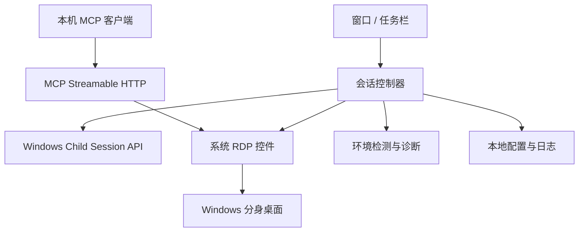

# STWin：通用 Windows 桌面分身工具

更新：2026-10-02。状态：开发预览已实现，真实连接和 Windows 显示兼容性仍需集成验证。

## 1. 产品定位与范围

STWin 是独立、通用、轻量的 Windows 桌面分身工具。用户一键打开额外桌面，在窗口内正常使用，随时最小化、恢复和结束。

设计只围绕桌面会话本身。软件不识别分身中运行什么应用，不依赖分身内安装任何配套程序。

实现依据为 Microsoft Learn 的 Windows 官方 API 文档和本机验证结果。独立编写实现，不复制、移植或以第三方项目源码为设计依据。

提供一个仅监听本机的 MCP 接口，让外部 Agent 查看分身画面并发送鼠标、键盘操作或 PowerShell 脚本。MCP 不在分身内安装常驻 Agent；界面操作通过现有 RDP 桌面转发，脚本通过分身中可见的 PowerShell 窗口提交。

## 2. 核心功能

- 一键启动：创建或恢复受本软件管理的桌面分身。
- 桌面窗口：显示完整桌面，提供缩放、全屏和置顶。
- 普通窗口：最小化后保留在任务栏，保持连接。
- 重复启动：唤回已有窗口，不再注册全局快捷键。
- 状态反馈：启动中、运行中、连接中断、正在结束及失败原因。
- 结束分身：明确提示保存工作后注销会话。
- 基础设置：记住窗口位置、大小和缩放；声音与系统组合键使用 RDP 原生能力。

主界面保持简单：一张桌面卡片、当前状态、一个主操作按钮和设置入口。系统权限与登录行为以官方文档为依据，并通过目标环境验证。

## 3. 生命周期

| 操作 | 行为 |
| --- | --- |
| 首次启动 | 检测必要能力，创建并连接子会话 |
| 重复启动 STWin | 唤回已有程序实例 |
| 最小化窗口 | 保留在任务栏，保持 RDP 连接 |
| 恢复窗口 | 显示现有连接；连接中断时提供“继续连接” |
| 结束分身 | 注销本次明确选择并核实身份的子会话 |
| 退出 STWin | 有分身时左侧选择保留分身并退出、右侧选择结束分身并退出；Esc 关闭提示、继续使用；没有分身时直接退出 |
| 保留后再次打开 | 查询 Windows 的现有子会话，主按钮显示“继续连接” |
| 崩溃后重启 | 查询真实会话状态，核实后恢复，不盲目新建或注销 |

最小化、断开连接、注销是不同操作。不能把关闭窗口直接等同于注销，也不能依靠对象释放隐式结束用户工作。

## 4. 技术方案

使用 C# + .NET 10 LTS + WPF，通过 Windows Child Session API 管理会话，使用系统 RDP ActiveX 控件呈现桌面。



只做一个桌面应用，先按模块划分代码，无需提前拆成多个进程、多个服务或大量工程。

```text
src/STWin/
  MainWindow.xaml    主界面与窗口事件
  Views/             确认对话框、连接界面状态
  Sessions/          会话生命周期与连接协调
  Windows/           WTS API、RDP 控件宿主、系统能力检测
  Infrastructure/    窗口唤回、单实例、配置与日志
  Mcp/                本机 Streamable HTTP MCP 服务
```

| 技术点 | 选择 |
| --- | --- |
| UI | WPF，当前使用自写 XAML 样式和窗口事件，未引入第三方组件库 |
| 桌面宿主 | WindowsFormsHost → AxHost → 系统 RDP ActiveX |
| 会话 API | WTSEnableChildSessions、WTSGetChildSessionId、WTSLogoffSession 等 |
| 连接方式 | localhost，设置 ConnectToChildSession |
| 配置 | System.Text.Json，本地用户目录 |
| 日志 | 本地滚动日志，保留失败阶段和系统错误码 |
| Agent 接口 | 本机 TCP 回环监听 Streamable HTTP MCP，不鉴权，配置写入 `%LocalAppData%/STWin/mcp-connection.json` |
| 发布 | 自包含 Windows x64 包，无需单独安装 .NET |

权限方案先在最小验证中确认。仅为必要的会话操作申请系统权限；不预设常驻服务或权限代理进程，只有实测证明需要时才增加最小辅助组件。

## 5. 必须处理的技术细节

### 状态管理

分别记录会话是否存在、RDP 是否连接、窗口是否可见。查询失败应标记未知，不能当成会话不存在。启动、重连、注销串行执行，防止重复点击造成冲突；设置超时和有限重试，忽略过期回调。

当前界面通过 `DesktopUiState` 统一计算按钮可用性、操作文案与桌面宿主可见性，不能用宿主已经显示来判断连接成功。全屏由系统 RDP ActiveX 的 `FullScreen` 属性切换；显示及收起连接条、退出全屏快捷键交给控件本身处理，应用不绘制悬浮工具栏。控件进入全屏时会创建独立的系统窗口，原 WPF 容器必须隐藏，否则留下一块白色空窗口；离开全屏时恢复容器。系统跨屏快捷键只移动全屏画面，不一定移动控件创建的独立连接条。2026-10-05 的只读窗口检查确认：全屏画面位于第一屏、连接条位于第二屏，隐藏的宿主窗口也位于第二屏。上一版只对 RDP 内部连接条调用 `SetWindowPos`，没有移动宿主，因而无法保证控件不将条复位。现改为检测画面与条的位置不一致后，将隐藏的宿主窗口定位到画面所在显示器，并通过控件的 `FullScreen` 属性退出、重进原生全屏，让控件自身重新建立连接条；完成后再次检查并记录失败状态。监听本进程窗口位置事件，定时检查兜底。使用 `IMsTscAxEvents` 的进入、离开全屏和连接条最小化事件即时同步。连接条最小化会先还原容器再最小化，以保留任务栏入口；从任务栏恢复时重新进入全屏。弹出确认对话框前直接读取控件状态并退出全屏，避免状态缓存滞后。连接状态暂时读取失败不会永久停止检查，恢复后清除该检查产生的错误提示。按钮只保留键盘导航的焦点提示，鼠标点击不添加持久边框。

`SessionController.AvailableId` 是最近一次系统查询结果，与本次连接后确认管理的 `ManagedId` 分开记录。启动和定时检查都发现仍存在的子会话，点击“继续连接”明确选择该会话，并在连接前重新核对；不会把旧会话 ID 写入配置作为跨启动的永久身份。

### 控件与显示

RDP 控件在所属 STA/UI 线程创建、操作和销毁。耗时的系统等待不得阻塞界面。普通窗口中的应用标题栏位于桌面画面外侧；进入全屏后使用 RDP 控件原生连接条，避开 WPF 与原生控件叠加限制。

窗口自适应缩放与改变分身分辨率分开处理。日常键鼠交互由 RDP 控件处理；MCP 自动化将鼠标消息投递到 RDP 画面窗口，并通过 RDP 控件接口发送按键，不激活 STWin，也不依赖本机前台输入。声音和系统组合键设置如果需要重连，显示应用中的状态。

MCP 服务随主窗口启动、随退出关闭，监听 `127.0.0.1` 上的本机端口，不做鉴权。服务提供桌面状态、截图、鼠标、键盘、文本输入和 PowerShell 脚本工具。鼠标坐标按最近一张 MCP 截图的像素位置映射到 RDP 视口；鼠标与键盘消息直接投递到 RDP 画面 HWND，避免调用全局前台输入。截图使用 `PrintWindow(PW_RENDERFULLCONTENT)` 捕获 RDP 画面窗口，不切换 STWin 焦点。文本通过启用的剪贴板重定向粘贴，并尝试恢复之前的本机剪贴板。脚本通过后台键盘消息打开分身 Start 菜单、粘贴 PowerShell 命令并提交，不使用分身内服务或远程执行代理。脚本以该分身登录用户身份运行，应视为对分身内文件和系统的完全操作能力。

### 恢复与清理

会话 ID 不作为永久身份保存。恢复或注销前重新核实目标会话，防止操作过期 ID 或其他工具创建的未知会话。睡眠恢复后重新查询系统状态。

退出选择通过 `ExitChoice` 明确区分取消、保留和结束。对话框只显示左侧“保留分身并退出”和右侧“结束分身并退出”，初始焦点位于保留按钮。保留仅调用 RDP `Disconnect` 并等待断开后释放窗口和控件；结束才对对话框选择的会话调用注销，注销前重新核对。按 Esc 或关闭对话框视为取消，不执行断开或注销。查询会话失败时仍可选择保留退出，但不能结束身份未知的会话。程序异常退出后应具备恢复入口；系统关机、重启或父用户会话结束仍会终止子会话。

### 配置与诊断

配置保存到 `%LocalAppData%\STWin`，采用原子写入。保存用户偏好，不把历史连接状态当作系统当前状态。凭据由系统界面处理，不保存明文密码。

错误信息包含失败阶段、系统错误码和可执行建议。只有需要排查时提供详细日志。

## 6. 支持边界

- Microsoft 文档明确：整个系统同一时间只能有一个处于活动且已连接状态的 Child Session。本项目按一个额外桌面设计。
- 优先在 Windows 11 x64 上验证；各系统版本和版本类别通过检测与测试后声明支持。已读官方文档没有给出现代 Home/Pro 的完整支持矩阵，不根据第三方说明断言家庭版不可用。
- 分身仍共享本机系统、文件和用户数据，不提供虚拟机或沙箱隔离。
- 官方描述为通常自动登录；父会话使用智能卡登录，或尚未启用 Child Sessions 时属于文档列出的例外。当前 Windows 版本与账户登录方式仍需实测，不把第三方软件的凭据行为当作系统规范。快速体验优先通过保持连接与即时唤回实现。
- 应用自身的多实例或跨会话限制不由 STWin 接管解决。
- 组件缺失、系统策略或 RDP 环境冲突应明确报告，不自动改造系统。

## 7. 实施与验收

| 阶段 | 交付 | 验收 |
| --- | --- | --- |
| 技术验证 | 最小桌面窗口与会话管理 | 启动、显示、最小化恢复、重连、注销闭环，确认权限需求 |
| 可用版本 | 窗口唤回、单实例、设置与诊断 | 快速唤回，重复启动不冲突，结束行为明确 |
| 发布完善 | 兼容测试、恢复处理、安装包 | 多 DPI、多屏、中文输入法、账户登录、睡眠恢复、崩溃恢复与退出清理验证 |

测试集中在桌面生命周期和 Windows 兼容性。自动化测试覆盖状态转换、重复请求、超时与过期回调；真实 Windows 环境验证 RDP、登录、显示及系统退出行为。

后续迭代只围绕桌面启动速度、稳定性、窗口体验和系统兼容性展开。

## 8. Windows 官方依据

依据以下 Microsoft Learn 文档：

- [Child Sessions](https://learn.microsoft.com/en-us/windows/win32/termserv/child-sessions)：这是绑定父用户会话的特殊本机回环远程桌面会话。系统同一时间只允许一个活动且已连接的子会话；父会话结束时子会话也结束。子会话不能锁定，没有屏保和登录屏幕。
- [WTSEnableChildSessions](https://learn.microsoft.com/en-us/windows/win32/api/wtsapi32/nf-wtsapi32-wtsenablechildsessions)：启用或禁用系统 Child Session 能力，API 最低支持 Windows 8 / Windows Server 2012。
- [WTSGetChildSessionId](https://learn.microsoft.com/en-us/windows/win32/api/wtsapi32/nf-wtsapi32-wtsgetchildsessionid)：查询当前会话的子会话 ID。调用成功但返回 ULONG(-1) 表示没有子会话，必须与调用失败区分。
- [IMsRdpExtendedSettings.Property](https://learn.microsoft.com/en-us/windows/win32/termserv/imsrdpextendedsettings-property)：连接前设置 ConnectToChildSession=true，控件将连接重定向到本机子会话。
- [WTSLogoffSession](https://learn.microsoft.com/en-us/windows/win32/api/wtsapi32/nf-wtsapi32-wtslogoffsession)：注销指定会话，可选择等待完成或异步发起；调用失败读取 GetLastError。
- [IMsTscAx.Disconnect](https://learn.microsoft.com/en-us/windows/win32/termserv/imstscax-disconnect)：断开连接；关闭承载控件的窗口也会触发断开。
- [WTSDisconnectSession](https://learn.microsoft.com/en-us/windows/win32/api/wtsapi32/nf-wtsapi32-wtsdisconnectsession)：官方明确断开可以保留会话并允许后续重连。本实现使用 RDP 控件的 Disconnect。

据此确定最小实现流程：查询现有子会话 → 用户启动或继续连接 → 必要时启用 → 创建系统 RDP ActiveX 控件 → 设置 ConnectToChildSession → Connect → 核对并显示桌面 → 保留退出时断开，结束时注销目标子会话。

API 可用版本不等于完整产品兼容承诺。权限要求、当前账户登录行为、具体系统版本支持情况，以及断开后重新连接的行为，均在最小原型中验证。当前只完成文档核查，尚未进行运行验证。

